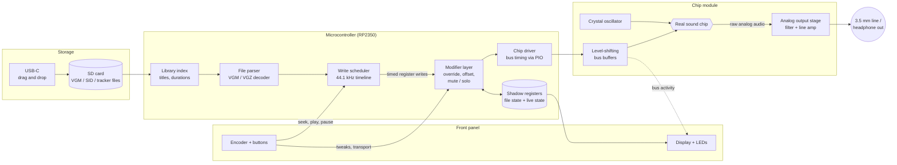

# Chip Shrine: Vintage Sound Chip Player — Design Doc

Status: Draft v0.1 · Oct 23, 2026 · Owner: Joey

> An iPod for sound chips. A desktop box where a real vintage chip, lit behind a
> glass window, plays your own music files while you reach into its registers.

This doc sets out **which chips the player supports**, **how it looks**, and
**how it works**, broken into milestones small enough to build one at a time.
Items marked **Decision** are proposals; items marked **Open** still need a call.

---

## 1. Goals and non-goals

**Goals**

- Real silicon only. The chip makes the sound live from register writes; nothing is emulated or pre-recorded.
- Plays user-provided files (VGM, SID, tracker rips) from an SD card, with CD-player style transport.
- Live tinkering: override, offset, mute/solo, snapshot, and reset the chip's registers while a song plays.
- One box per chip, sharing one design language so the series is collectible.
- Runs from a single USB-C cable.
- Open firmware and schematics, with a labeled header for hackers.

**Non-goals (v1)**

- No MIDI, CV, or Eurorack I/O.
- No emulation fallback if a chip is missing or dead.
- No battery, Wi-Fi, Bluetooth, or companion app.
- No cross-chip playback (a YM2612 box only plays Genesis/YM2612 music).

## 2. Supported chips

The series targets seven chips. Each box is a "chip module" on a shared main board
(see §5), so adding a chip means a new module board plus a firmware driver.

| Order | Chip | Found in | File formats | Supply | Difficulty | Notes |
| --- | --- | --- | --- | --- | --- | --- |
| 1 | **SN76489** | Master System, BBC Micro | VGM/VGZ | 5V | Low | 3 square + 1 noise; write-only; easy to drive |
| 2 | AY-3-8910 / YM2149 | ZX Spectrum, Atari ST, MSX | VGM, YM, PT3* | 5V | Low | Readable registers; lots of prior art |
| 3 | POKEY | Atari 8-bit | SAP, VGM | 5V | Medium | Needs 1.79 MHz clock; distinctive sound |
| 4 | YM3812 (OPL2) | AdLib, Sound Blaster | VGM, DRO, IMF | 5V + DAC | Medium | Needs external YM3014 DAC; FM |
| 5 | YM2612 | Sega Genesis | VGM/VGZ | 5V | High | Hero chip; strict write timing; DAC + PCM channel |
| 6 | SID 6581 / 8580 | Commodore 64 | SID (PSID/RSID) | 5V + 12V (6581) / 9V (8580) | High | Iconic, pricey; needs boost rail; PSID needs a 6502 player (see §4.3) |
| 7 | Konami SCC | Konami MSX carts | VGM, KSS* | 5V | High | Rare; sourcing risk |

\* Formats marked with an asterisk are tracker/player formats that need a small
per-format player routine in firmware, not just a register-stream reader.
Phase 1 supports **VGM only**, because VGM is already a timed list of register
writes for every chip above except SID.

**Decision (pending Joey):** pilot chip is the **SN76489**. It is digital, 5V,
cheap to verify, and has thousands of Master System and BBC VGM rips. Proving the
whole pipeline on it de-risks firmware and hardware before the harder chips.

## 3. How it looks

A grown-up desktop instrument: part synth, part retro computer, part museum piece,
with the chip as the centerpiece.

### 3.1 Front panel layout

```
 ┌──────────────────────────────────────────────────────────────────┐
 │  CHIP SHRINE                                   SN76489  № 0042   │
 │  ┌───────────────┐   ● ● ● ● ● ● ● ●   DATA                       │
 │  │               │   ● ● ● ● ● ● ● ●   ADDR / CTRL               │
 │  │  [ the chip ] │   ●  CLK  ●  WE                               │
 │  │  lit window   │   ┌──────────────────────────┐                │
 │  │               │   │ 03  Green Hill (Zone 1)  │   ( ENCODER )  │
 │  └───────────────┘   │ 01:24 / 02:51   LOOP A-B │                │
 │                      │ CH1 ▮▮▮▯ CH2 ▮▯▯▯ ...    │                │
 │                      └──────────────────────────┘                │
 │   |◀◀   ◀◀   ▶❙❙   ■   ▶▶   ▶▶|      [MUTE 1-4]  [SNAP]  [RESET]   │
 └──────────────────────────────────────────────────────────────────┘
          pinout silkscreen ▸ printed register map on the lid
```

### 3.2 Visual elements

- **Chip window:** a cut-out with warm edge lighting. A black plastic package won't glow from behind, so light rakes across the top and the markings shine. Same window size and position on every box in the series.
- **Blinkenlights:** LEDs on the data bus, address/control lines, and clock, in the spirit of Altair and PDP-8 panels. They are driven from buffered copies of the bus, never from the chip pins directly.
- **Display:** a 2.4"–2.8" color IPS screen (320×240) showing title, time, loop state, per-channel activity, and register values. No sleep mode.
- **Finish:** three options for the series: beige, black, brushed metal. Period-correct typeface (for example a DIN or Eurostile-like face).
- **Silkscreen:** the chip's datasheet pinout printed on the case beside the window.
- **Collector details:** a plate with the chip's date code and the unit's serial number, a printed register map on the lid underside, and a datasheet booklet in the box.

### 3.3 Controls

**Decision:** one **clickable rotary encoder plus the screen** is the main control
(browse library, pick a register, change its value). Dedicated buttons cover the
things users do constantly: transport (prev, rew, play/pause, stop, ff, next),
per-channel mute, snapshot, and reset. Physical knobs for "favorite" registers
are a later add-on via the expansion header (see §5.4), because the useful
registers differ per chip.

## 4. How it works

### 4.1 Audio pipeline



In plain words: the microcontroller reads a music file, works out *when* each
register write should happen, lets the user's tweaks alter those writes, keeps a
copy of every register's value, and then wiggles the real chip's pins to make the
write. The chip produces the sound, which is cleaned up and sent to the output jack.

### 4.2 Firmware modules

| Module | Job |
| --- | --- |
| **Storage** | FAT32 on SD (FatFs). Scans folders, builds a cached library index. |
| **USB** | USB mass storage so the SD card shows up as a drive on a computer. Playback pauses while the host has the card mounted. |
| **Parser** | Turns a file into a stream of `(wait, register, value)` events. VGZ is gunzipped on the fly. One parser per format, behind a common interface. |
| **Scheduler** | Runs on its own core. Releases each event at the exact sample time (VGM uses 44.1 kHz ticks). Handles play, pause, stop, loop, A-B repeat. |
| **Modifier layer** | Applies live tweaks to each write before it reaches the chip (see §4.4). |
| **Shadow registers** | Two tables: what the *file* last wrote, and what was *actually sent*. Needed because most of these chips are write-only. |
| **Chip driver** | One per chip. Knows the bus protocol, write timing, register map, and how to silence the chip. Uses RP2350 PIO for precise bus timing. |
| **UI** | Screen, encoder, buttons, and LEDs. Runs on the other core so drawing never delays a write. |

The chip driver interface is the seam that makes the series possible:

```c
typedef struct {
    const char *name;               // "SN76489"
    uint8_t     num_registers;
    uint8_t     num_channels;
    void (*init)(void);             // reset + clock check
    void (*write)(uint16_t reg, uint8_t value);
    void (*silence)(void);          // all channels off
    const reg_info_t *register_map; // names, bit fields, ranges for the UI
} chip_driver_t;
```

### 4.3 Playback and file formats

- **VGM/VGZ (Phase 1):** a ready-made timed list of register writes. The parser reads it; the scheduler plays it.
- **Tracker/player formats (YM, PT3, SAP, KSS, DRO):** handled by small per-format player routines that generate the same event stream.
- **SID files:** most PSID files contain 6502 code that a C64 would run. The SID box will run a small 6502 CPU emulation on the MCU to produce register writes, while the *sound* still comes from the real SID. This keeps the "no emulation" promise for audio. **Open:** confirm this is acceptable to the target audience.

### 4.4 Live tinkering

Every write from the file passes through the modifier layer:

```
file value ─▶ [ mute/solo ] ─▶ [ override? use user value ]
                              ─▶ [ offset? add user delta, clamp ] ─▶ chip
```

1. **Override:** hold a register at the user's value and ignore the file.
2. **Offset:** add or subtract from the file's value, so the song still moves but bends.
3. **Mute/solo:** silence or isolate a channel by forcing its volume register to off.
4. **Snapshot:** save the current set of overrides/offsets/mutes to the SD card (up to 8 per song) and recall them later.
5. **Reset:** clear all tweaks and immediately re-send the file's shadow values, so the chip snaps back to the original song.

When a tweak is removed, the driver re-sends the file's shadow value for that
register so there is no leftover state.

### 4.5 Seeking

Most of these chips are write-only, so we can't read their state back. To jump to 1:30:

1. Silence the chip.
2. Replay the file from the start **without writing to the chip**, only updating the shadow registers, until 1:30.
3. Write the whole shadow table to the chip in one burst.
4. Resume normal playback.

For a few-KB VGM this takes milliseconds. Fast-forward/rewind reuse the same
mechanism in steps. Loop and A-B repeat are seeks triggered by the scheduler.

### 4.6 Timing budget

- Scheduler resolution: 1/44,100 s (about 22.7 µs), matching VGM.
- FM chips are the tightest case: the YM2612 and OPL2 need a short wait after each write before accepting the next. PIO handles the bus strobe, and the driver enforces a minimum gap per chip, measured on a logic analyzer against the datasheet.
- UI drawing and SD reads run on the other core and are buffered so they can never stall a write.

## 5. Hardware

### 5.1 Block diagram

```
USB-C ─┬─ 5V ─ ferrite ─ LDO 3.3V ── MCU, SD, display (digital)
       │        └─────── LDO 5V A ── chip analog + output stage
       │        └── boost 9V/12V ── SID only
       └─ USB data ── MCU (mass storage)

MCU ── PIO bus ── 74LVC/74HCT level shifters ── chip module ── output stage ── 3.5 mm
```

### 5.2 Main board (shared by every box)

- **MCU:** Raspberry Pi RP2350. **Decision:** chosen for dual cores (playback vs. UI), PIO for exact bus timing, native USB mass storage, low cost, and a large hobbyist community, which helps the "hackable and open" goal.
- **Storage:** microSD slot; USB-C drag-and-drop exposes it as a drive.
- **Power:** USB-C with two 5.1 kΩ resistors on CC for 5V. SID boxes add either a boost converter or a USB-PD trigger chip for 9–12V.
- **Clean audio:** separate analog and digital supply paths, LDO regulators, ferrite beads, and a star ground. **Open:** add an isolated output (audio transformer) to stop ground-loop hum when plugged into a computer and an amp at once.
- **Output:** 3.5 mm line out and a headphone amp with volume knob.
- **Expansion header:** labeled pins for UART (PEEK/POKE serial monitor), I²C (add-on knobs), and SWD (flashing/debugging).

### 5.3 Chip module (one per chip type)

- Socketed chip (ZIF or turned-pin) so the chip can be inspected and replaced.
- Crystal oscillator at the chip's native clock (for example 3.579545 MHz for the SN76489 and OPL2, about 7.67 MHz for the YM2612).
- Level-shifting buffers between the 3.3V MCU and the 5V chip.
- Chip-specific analog stage: output filter, any external DAC (YM3014 for OPL2), and the right load for the chip's output.
- Edge-lit window mount and the LED taps for the blinkenlights.

### 5.4 Protecting the chip

These chips may be irreplaceable, so:

- Series resistors and buffers on every user-reachable pin.
- Clock and supply pins are never exposed on the header.
- Reverse-polarity and overvoltage protection on the input.
- Blinkenlights and any "pin ring" pads are driven from buffered copies, never the chip pins.

## 6. Milestones

Each milestone ends with something you can hear or hold.

| # | Milestone | Done when |
| --- | --- | --- |
| M0 | **Source the pilot chip** | Verified genuine SN76489 in hand, plus a known-good spare. |
| M1 | **First sound** | Breadboard: RP2350 + SN76489 + crystal plays a hard-coded tone. |
| M2 | **Play a VGM** | A VGM file from SD plays start to finish through the scheduler and driver. |
| M3 | **Transport** | Play, pause, stop, next/prev, library browsing on a dev screen with encoder. |
| M4 | **Shadow registers and seek** | Seek, FF/REW, loop, and A-B repeat work without glitches. |
| M5 | **Live tinkering** | Override, offset, mute/solo, snapshot, reset. |
| M6 | **Clean audio and power** | USB-C power, analog stage, noise floor measured and acceptable. |
| M7 | **Enclosure mock-up** | Lit window, panel layout, and finish prototyped (3D print or laser-cut). |
| M8 | **PCB v1** | Main board + SN76489 module, first complete unit. |
| M9 | **Second chip** | AY-3-8910 module and driver prove the series design. |

## 7. Risks

| Risk | Impact | Mitigation |
| --- | --- | --- |
| Counterfeit or dead chips | High | Buy from known sellers, test every chip on a bench rig before building, keep spares. |
| Chip cost and scarcity | High | Start with cheap chips; plan small numbered runs for rare ones. |
| Prior art (SID and AY players exist) | Medium | Lean on the differentiators: lit window, blinkenlights, live register panel. |
| Write timing on FM chips | Medium | PIO-driven bus, measured on a logic analyzer per chip. |
| Audio noise over USB power | Medium | Separate rails, LDOs, ferrites; optional isolated output. |
| User damages chip via header | High | Buffers, series resistors, no clock/supply pins exposed. |

## 8. Open questions

- [ ] Pilot chip: SN76489 (recommended) or AY-3-8910?
- [ ] Is a 6502 player for SID files acceptable, given "no emulation" refers to the audio?
- [ ] Personal builds, a small batch, or a product line? This drives PCB vs. hand-wired and the enclosure method.
- [ ] Ship with a tested chip, or without one?
- [ ] Include an isolated audio output on every box, or only as an option?

## 9. Glossary

- **Register:** a tiny memory slot inside the chip; writing a number to it changes pitch, volume, or tone.
- **Register write:** sending one number to one register. Music on these chips is just a timed stream of these.
- **VGM:** "Video Game Music," a file format that records every register write a game made, with timing.
- **Shadow register:** the player's own copy of what each register holds, because the chip can't be read back.
- **PIO:** programmable I/O blocks on the RP2350 that toggle pins with exact timing, independent of the CPU.
- **Blinkenlights:** front-panel LEDs that show the computer's (here, the chip's) bus activity.
