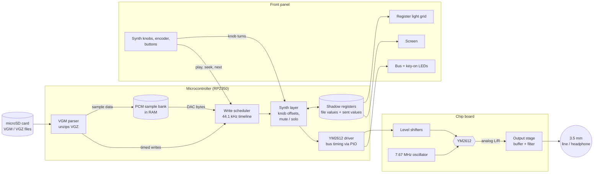

# Chip Shrine: YM2612 Player — Proof of Concept Design

Status: Draft v0.3 · Oct 23, 2026 · Owner: Joey

> A desktop box with a real Sega Genesis sound chip, the Yamaha YM2612, lit behind
> a window. It plays VGM files, shows what the chip is doing on a wall of lights,
> and lets you grab the chip's registers to bend the sound while a song plays.

This is a **proof of concept** for one chip only. Swappable chips and a product
series are deliberately out of scope (see §9). Items marked **Proposal** are
recommendations waiting for Joey's OK; items marked **Open** still need a call.

---

## 1. Goals and non-goals

**Goals**

1. Play Sega Genesis / Mega Drive **VGM and VGZ** files on a real YM2612.
2. **Lights show the chip's registers** as the music writes them.
3. **Synth controls** (knobs like Brightness, Attack, Release) to mess with the sound live, with a Bypass button to hear the original song.
4. CD-player style transport: play, pause, stop, next/previous, seek, loop.
5. Powered from one USB-C cable.
6. Joey designs and 3D prints the enclosure; this doc defines what has to fit in it.

**Non-goals for the proof of concept**

- Other chips, swappable chip modules, or a shared platform for a series.
- Formats other than VGM/VGZ.
- MIDI, CV, Eurorack, Wi-Fi, Bluetooth, battery, companion app.
- A custom PCB. Dev boards and protoboard are fine; a PCB comes after the concept works.
- Emulation of any kind. The sound comes from the real chip.

## 2. The chip: YM2612 at a glance

What the design has to work with:

| Fact | Why it matters |
| --- | --- |
| 6 FM channels, each with 4 operators | Lots of sound-shaping registers to light up and control |
| Channel 6 can switch to an 8-bit DAC for samples | Genesis drums and voices; needs fast, steady writes |
| Two register banks ("ports"): port 0 = channels 1–3 + global settings, port 1 = channels 4–6 | The driver addresses ~320 registers through 2 address lines |
| 24-pin DIP, 5V, NMOS | Socket it; level-shift from the 3.3V microcontroller |
| Clock about 7.67 MHz (NTSC Genesis) | Needs its own oscillator; the VGM header states the exact clock |
| Write-only registers; only a status byte can be read | Player must keep its own copy of every register (shadow registers) |
| Needs a short wait after each write (busy flag) | Driver polls the busy bit or enforces a measured minimum gap |
| Analog outputs MOL / MOR with the chip's famous slightly gritty DAC | Needs a buffered output stage; the grit is part of the charm |

**Open — the Genesis PSG.** Genesis music also uses a second chip, the SN76489-style
PSG, for some square-wave parts, hi-hats, and effects. VGM files contain those writes
too. Options:

- **A (proposal for v1):** ignore PSG writes. Most songs still sound complete, some lose a part; the screen shows a small "PSG parts muted" note.
- **B:** add a real SN76489 next to the YM2612. Songs are complete; adds a chip, a second output to mix, and a little firmware.
- **C:** leave room for B on the board and in the enclosure, build A first.

## 3. How it works

### 3.1 Audio pipeline



In plain words: the microcontroller reads a VGM file, which is a list of "write
this value to this register, then wait this long". It plays those writes at the
right moments, lets your tweaks change them on the way through, remembers every
value it sent, and lights up the panel to match. The YM2612 makes the actual sound.

### 3.2 Firmware modules

| Module | Job |
| --- | --- |
| **Storage** | FAT32 microSD (FatFs). Scans folders and builds a track list. |
| **VGM parser** | Reads the header (clock, length, loop point, title tags) and turns commands into `(wait, port, register, value)` events. Handles YM2612 writes, waits, PCM data blocks, DAC writes, and the DAC stream commands. PSG writes are skipped or routed (see §2). |
| **PCM bank** | Holds the song's sample data in RAM so drum and voice samples can be fed to the DAC at full speed. Some VGMs carry several hundred KB of samples, so the board should have PSRAM. |
| **Scheduler** | Runs on core 1. Releases each write at its exact sample time and handles play, pause, stop, loop, A-B repeat. |
| **Synth layer** | Applies the knob offsets, mutes, and channel select to each write before it reaches the chip (§5). |
| **Shadow registers** | Two copies of all ~320 registers: what the file last wrote, and what was actually sent. Drives seeking, bypass, and the lights. |
| **YM2612 driver** | Pin-level bus writes via PIO: set A1/A0, put data on D0–D7, pulse /WR, then wait for the busy bit to clear. Also reset (/IC) and silence. |
| **UI** | Runs on core 0: screen, controls, LED grid, bus LEDs. Never blocks a chip write. |

### 3.3 Seeking

The chip can't be read back, so to jump to 1:30:

1. Key off all channels and mute the DAC.
2. Run the file from the start **without writing to the chip**, updating only the shadow registers, up to 1:30.
3. Write the whole shadow table to the chip in one burst, then re-send the key-on state.
4. Resume playback.

This takes milliseconds for a typical file. Fast-forward, rewind, loop, and A-B repeat all reuse it.

### 3.4 Timing budget

- Scheduler resolution: 1/44,100 s (about 22.7 µs), same as VGM.
- Sample-heavy tracks write the DAC thousands of times per second, so DAC writes get priority and the bus is driven by PIO, not by the CPU.
- Minimum gap between writes: measured on a logic analyzer against the busy bit during M1, then fixed in the driver.

## 4. The lights

**Proposal:** three groups of lights, all driven by the microcontroller from the
shadow registers, never wired to the chip's own pins (that keeps the chip safe and
makes the lights readable instead of a blur).

### 4.1 Register grid (the centerpiece)

A **32 × 8 addressable LED panel** (a common, cheap WS2812 matrix) laid out as a
map of the chip, so each light *means* something:

```
            CH1         CH2         CH3         CH4         CH5         CH6       GLOBAL
         op1 2 3 4   op1 2 3 4   op1 2 3 4   op1 2 3 4   op1 2 3 4   op1 2 3 4   ........
DT/MUL    ■ ■ ■ ■     ■ ■ ■ ■     ...                                            LFO
TL        ■ ■ ■ ■                                                                 DAC on
KS/AR     ■ ■ ■ ■                                                                 DAC level
AM/DR     ■ ■ ■ ■                                                                 CH3 mode
SR        ■ ■ ■ ■                                                                 key-on 1-6
SL/RR     ■ ■ ■ ■                                                                 ...
SSG-EG    ■ ■ ■ ■
CHANNEL   freq · block · FB/ALG · pan/LFO sens (one cell each)
```

- **Brightness** = the register's current value.
- **Flash** = the register was just written; it fades over about 100 ms.
- **Color** = who set it: warm white when the value is the song's own, amber when a knob is bending it.
- The **selected channel** (§5.1) is outlined, so you can see which columns the knobs affect.

### 4.2 Bus blinkenlights

11 LEDs in a row: D7–D0, A1, A0, /WR. They mirror the last write, held for a few
milliseconds so they flicker like a 70s front panel instead of staying dimly lit.

### 4.3 Key-on lights

7 LEDs: one per channel that lights on each note, plus one for the DAC.

**Power note:** 256 RGB LEDs at full white could draw several amps. Firmware caps
total LED brightness to stay inside a 5V 3A USB-C budget, and the LEDs get their own
supply path and ground return so they don't hum into the audio.

## 5. The controls

**Decision (Joey, Oct 23):** synth controls only, no direct register editing. The
knobs change the chip's registers behind the scenes, but you work with musical ideas
like "Brightness" and "Attack", never raw register numbers.

### 5.1 How the knobs behave

- Every knob is centered on **"the song as written"**. Turning it bends the sound up or down from there, and the song keeps playing its own changes underneath.
- Knobs are potentiometers with a **center detent**, so the "as written" position is easy to feel.
- Knobs act on the **selected channel** or **all channels**. A **Channel** button steps through All → 1 → 2 … → 6, and the screen and grid show which one is selected.
- **Bypass** button: hear the untouched song while held (or toggled), to compare.
- Settings that would produce silence or a painful sound are clamped by the firmware, and the output stage has a limiter.

### 5.2 The 10 synth knobs

Laid out in two rows of five. Songs that use the chip's own vibrato or tremolo (LFO) still play it as written; there are no knobs for it.

| # | Knob | Under the hood | Sound |
| --- | --- | --- | --- |
| 1 | Algorithm | ALG. Fully left = song's own; then the 8 algorithms | How the 4 operators are wired; changes the whole instrument |
| 2 | Feedback | FB offset | Clean to buzzy to noisy |
| 3 | Brightness | TL offset on *modulator* operators only (firmware knows the algorithm, so carriers are left alone) | Dull to bright/harsh |
| 4 | Harmonics | MUL offset | Overtones; bells, metallic tones |
| 5 | Detune | DT + fine frequency offset | Chorus-like thickness |
| 6 | Transpose | Frequency/block offset in semitones (±12) | Pitch up/down |
| 7 | Attack | AR offset | Plucky vs. swelling |
| 8 | Decay | DR / SL offset | How fast the note falls after the hit |
| 9 | Sustain | SR offset | How long the held part lasts |
| 10 | Release | RR offset | Short vs. ringing tails |

Plus an analog **volume** knob on the output.

### 5.3 Buttons and encoder

- **Encoder + screen:** browse folders and tracks only.
- **Transport:** previous, rewind, play/pause, stop, fast-forward, next.
- **Channel mute 1–6 + DAC:** tap to mute, hold to solo. Each sits under its channel's column on the grid.
- **Channel select** and **Bypass** (§5.1).
- **Loop / A-B:** loop one section while you play with the knobs.

### 5.4 Later: expert mode

Direct register editing (the "POKE a value" idea from the original notes) is left out of the
proof of concept. It can come back later as a hidden expert mode on the same hardware,
since the firmware already keeps every register in its shadow table.

## 6. Hardware for the proof of concept

```
USB-C 5V ─┬─ ferrite ─ 3.3V ── RP2350 board, screen, SD
          ├─ ferrite ─ LDO 5V (analog) ── YM2612 + output stage
          └─ separate path ── LED grid + bus LEDs (brightness-capped)

RP2350 ── PIO bus ── level shifters ── YM2612 (socketed) ── op-amp buffer/filter ── 3.5 mm
```

| Part | Proposal |
| --- | --- |
| Microcontroller | RP2350 board with PSRAM (for example Pimoroni Pico Plus 2). Two cores, PIO for exact bus timing, room for big sample banks. |
| Chip socket | 24-pin ZIF or turned-pin socket, centered under the window |
| Clock | 7.67 MHz crystal oscillator can |
| Level shifting | 74HCT-series buffers for 3.3V → 5V writes; a 5V-tolerant buffer or divider for reading the busy bit. Confirm thresholds against the datasheet. |
| Audio out | Op-amp buffer and low-pass filter on MOL/MOR, based on a known-good Genesis model 1 output stage; 3.5 mm line out plus a headphone amp with volume knob |
| Screen | 2.0"–2.8" color IPS (SPI) |
| Lights | 32×8 WS2812 panel, 11 + 7 discrete LEDs |
| Controls | 10 center-detent potentiometers, 1 volume pot, 1 clickable encoder, about 18 buttons |
| Power | USB-C with 5.1 kΩ resistors on CC for 5V; needs a 3A-capable supply because of the LEDs |
| Storage | microSD slot, reachable from outside the case |
| Build | Protoboard or a carrier board for the RP2350 and chip; the PCB comes later |

**Protecting the chip:** series resistors on every bus line, no user-reachable pins,
reverse-polarity protection on the input. Keep a spare YM2612 on hand.

**Sourcing:** YM2612s are pulled from old consoles and are widely counterfeited. Buy
from a seller with returns, and test each one on the breadboard rig (M1) before it goes
in the box. A YM3438 (the later CMOS version) sounds cleaner and lacks the gritty DAC;
note which one you have.

## 7. Enclosure (Joey designs and prints)

What the case needs to hold and expose:

- **Chip window:** the YM2612 visible under a clear window with warm edge lighting raking across the top so the markings glow.
- **Register grid:** 32×8 panel behind a diffuser, ideally with a printed light-blocking grid so each cell reads as its own square. Column and row labels printed or engraved on the panel (§4.1).
- **Bus and key-on LED rows** near the grid.
- **Screen**, **encoder**, **10 synth knobs in two rows of five**, **volume knob**, **~18 buttons**, with the 7 mute buttons lined up under the grid's channel columns.
- **Rear or side:** USB-C, 3.5 mm line out, headphone jack + volume, microSD slot.
- **Inside:** standoffs for the RP2350 board and the chip/audio board; keep the audio board away from the LED panel's power wiring.
- **Style ideas from the notes:** beige or black finish, period font, the YM2612 pinout printed beside the window.

Exact dimensions get filled in once the screen, LED panel, knobs, and buttons are bought (M5).

## 8. Milestones

Each one ends with something you can hear or see.

| # | Milestone | Done when |
| --- | --- | --- |
| M0 | **Parts in hand** | Tested-good YM2612 (plus a spare), RP2350 board, oscillator, level shifters, op-amp parts |
| M1 | **First sound** | Breadboard plays a hard-coded FM note; write timing measured on a logic analyzer |
| M2 | **Play a VGM** | A Genesis VGM plays start to finish from microSD, samples included |
| M3 | **Transport + screen** | Track list, play/pause/stop/next/prev, title and time on screen |
| M4 | **Shadow registers + seek** | Seek, FF/REW, loop, A-B repeat without glitches |
| M5 | **Lights** | Register grid, bus LEDs, and key-on LEDs working; parts measured for the enclosure |
| M6 | **Synth controls** | 10 knobs, channel select, bypass, mute/solo |
| M7 | **Clean power + audio** | USB-C only, LED brightness cap, no audible hum or LED noise |
| M8 | **In the box** | Everything mounted in Joey's 3D-printed enclosure |

## 9. Later versions (out of scope now)

- Other chips (SN76489, AY-3-8910, OPL2, POKEY, SID, SCC) and a swappable chip-module design.
- Custom PCB.
- USB drag-and-drop file loading.
- Expert mode for direct register editing (§5.4), serial PEEK/POKE monitor, expansion header, USB keyboard input.
- Isolated audio output for ground-loop-free use with a computer and an amp.

## 10. Open questions

- [ ] Genesis PSG parts: ignore (A), add a real SN76489 (B), or build A with room for B (C)?
- [ ] Register grid as proposed (32×8 LED panel), or something different?
- [ ] Headphone amp, or line out only?

## 11. Glossary

- **Register:** a tiny memory slot in the chip; writing a number to it changes pitch, volume, or tone.
- **Operator:** one of the 4 sine-wave generators inside each FM channel. *Carriers* are heard; *modulators* bend the carriers' tone.
- **Algorithm:** how a channel's 4 operators are wired together (8 options).
- **VGM / VGZ:** "Video Game Music", a recording of every register write a game made, with timing. VGZ is the zipped version.
- **Shadow register:** the player's own copy of a register's value, because the chip can't be read back.
- **PIO:** programmable I/O blocks on the RP2350 that toggle pins with exact timing.
- **DAC:** the YM2612's sample-playback mode on channel 6, used for drums and voices.
- **PSG:** the Genesis's second, simpler sound chip (SN76489-style).
