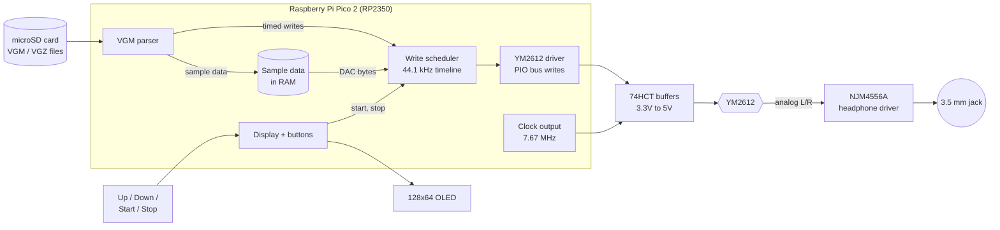

# Chip Shrine: YM2612 Player — Rev A Design

Status: Draft v0.4 · Oct 24, 2026 · Owner: Joey

> A small box with a real Sega Genesis sound chip, the Yamaha YM2612. Put VGM files
> on a microSD card, pick a song with the buttons, and hear the real chip play it
> through a headphone jack.

**Rev A is the simplest, lowest-cost version that plays music.** It does VGM import and
playback and nothing else. The lights, synth knobs, fuller transport, and lit window
designed earlier are parked in [LATER-REVISIONS.md](LATER-REVISIONS.md) for Rev B and on.

Joey is drawing the schematic and PCB in a KiCad project called **YM2612 player**. This
doc is the reference for what goes on that board. Items marked **Proposal** are
recommendations waiting for Joey's OK; items marked **Open** still need a call.

---

## 1. What Rev A does

**Features (the whole list)**

1. **VGM import:** copy `.vgm` (and ideally `.vgz`) files onto a microSD card on any computer, then put the card in the player.
2. **Playback** on a real YM2612.
3. **One 3.5 mm stereo jack** that drives headphones and also works as a line out.
4. **A display** that shows the file being played.
5. **Four buttons:** Up, Down, Start, Stop.

**Not in Rev A**

- Lights, synth knobs, register editing, lit chip window (see [LATER-REVISIONS.md](LATER-REVISIONS.md)).
- Pause, next/previous, seek, loop, A-B repeat.
- Volume control (see Open questions, §8).
- Genesis PSG parts: only the YM2612 plays (decided Oct 23).
- Other chips, battery, wireless, MIDI.

## 2. How you use it

1. Plug the player into a USB charger or computer. The display shows the first track on the card.
2. **Up / Down** move through the track list.
3. **Start** plays the selected track. The display shows the name and elapsed time.
4. **Stop** stops playback and returns to the track list.
5. When a track ends, the player stops. If the file has a loop point, the looped part plays
   **twice**, then the player stops.

### Display (128 × 64 OLED)

```
┌────────────────────────┐
│ ▶ 03/27        01:24   │   play state, track number / total, time
│ Green Hill Zone        │   title from the VGM's GD3 tag
│ Sonic the Hedgehog     │   game name (falls back to the filename)
│ PSG parts skipped      │   only shown when the file uses the PSG
└────────────────────────┘
```

When stopped, the screen shows a scrolling list of tracks with the selected one highlighted.

## 3. The chip: YM2612 at a glance

| Fact | What Rev A does about it |
| --- | --- |
| 6 FM channels with 4 operators each; channel 6 can play 8-bit samples (DAC) | Firmware plays all of it, including drum and voice samples |
| Two register banks, selected with address lines A0 and A1 | 2 GPIO lines |
| 24-pin DIP, 5V, NMOS | DIP socket; 3.3V → 5V buffers between the Pico and the chip |
| Clock about 7.67 MHz (NTSC Genesis) | Generated by the Pico, no oscillator part needed (§5.3) |
| Registers are write-only; the status byte can be read | Rev A never reads it. /RD is tied high, so the bus is one-way |
| Needs a short wait after each write | Fixed minimum gap, measured on a logic analyzer in M1 |
| Analog outputs MOL / MOR | Op-amp headphone driver (§5.4) |

## 4. How it works

### 4.1 Audio pipeline



In plain words: the Pico reads a VGM file from the card. The file is a list of "write
this value to this chip setting, then wait this long". One of the Pico's two cores
plays those writes to the YM2612 at the right moments. The other core runs the display
and buttons. The YM2612 makes the sound, and the op-amp makes it loud enough for
headphones.

### 4.2 Firmware modules

| Module | Job |
| --- | --- |
| **Storage** | FAT32 microSD over SPI (FatFs). Builds the track list from the card's files. |
| **VGM parser** | Reads the header (clock, length, loop point) and GD3 tags (title, game). Turns commands into timed writes: YM2612 port 0/1 writes, waits, PCM data blocks, DAC writes, and DAC stream commands. Skips PSG writes. VGZ files are unzipped while loading (nice to have in Rev A; VGM is the must). |
| **Sample data** | Loads the song's PCM samples into RAM (the Pico 2 has 520 KB). If a file's samples don't fit, they're streamed from the card through a buffer. |
| **Scheduler** | Runs on core 1. Releases each write at its exact sample time (1/44,100 s). Stops at the end, or after the loop has played twice. |
| **YM2612 driver** | PIO program: put A1/A0 and D0–D7 on the pins, pulse /WR, wait the minimum gap. Also pulses /IC (reset) at power-up and on Stop to silence the chip. |
| **UI** | Runs on core 0. Debounces the 4 buttons and draws the OLED. Never delays a chip write. |

## 5. Hardware

### 5.1 Block diagram

```
Pico micro-USB ── VBUS 5V ─┬─ ferrite + caps ── YM2612, 74HCT buffers
                           ├─ ferrite + caps ── NJM4556A (audio)
                           └─ Pico's own 3.3V regulator ── Pico, OLED, microSD

Pico GPIO ── 2× 74HCT541 ── YM2612 (DIP socket) ── NJM4556A ── 3.5 mm jack
     ├── SPI ── microSD socket
     ├── I²C ── OLED module
     └── 4 buttons to GND
```

### 5.2 Parts (Proposal)

| Part | Choice | Rough cost |
| --- | --- | --- |
| Microcontroller | **Raspberry Pi Pico 2** (RP2350), soldered by its castellated edges or on headers | $5 |
| Sound chip | YM2612, pulled from a Model 1 Genesis or bought tested | $5–15 |
| Chip socket | 24-pin DIP, turned-pin | $0.50 |
| Level shifting | 2× 74HCT541 (one-way 3.3V → 5V buffers, powered from 5V) | $1 |
| Headphone driver | NJM4556A dual op-amp, single 5V supply, AC-coupled output | $1 |
| Audio jack | 3.5 mm stereo (TRS) PCB jack | $0.50 |
| Display | 0.96" 128×64 SSD1306 OLED module, I²C, 4 pins | $2–3 |
| Storage | microSD socket (SPI mode) | $0.50–1 |
| Buttons | 4× 6 mm tactile switches | $0.40 |
| Power | Pico's own micro-USB port (no extra connector) | $0 |
| Passives | Decoupling, ferrites, op-amp resistors and caps, output caps | $2 |
| PCB | 2-layer, about 100 × 70 mm | about $1 each in a batch of 5 |

**Rough total: $20–30 per board** before the enclosure, mostly depending on the YM2612's price.

### 5.3 Cost savers in this design

- **No crystal oscillator for the chip.** The RP2350 runs at 153.33 MHz (12 MHz × 115 ÷ 9),
  and its clock-output pin divides that by 20 to give **7.667 MHz**, within 0.05% of
  a real Genesis (less than 1 cent of pitch). The clock goes through a spare 74HCT541
  channel to reach 5V levels. **Proposal:** add an unpopulated footprint for an oscillator
  can as a fallback.
- **No busy-flag reads,** so the buffers only go one way and /RD is tied high.
- **No USB connector, regulator, or power switch.** The Pico's micro-USB port powers everything.
- **No volume control** (see §8).

### 5.4 Pin map (Proposal)

Consecutive pins keep the PIO program simple. Check each against the RP2350 datasheet in KiCad.

| Pico GPIO | Signal | Goes to |
| --- | --- | --- |
| GP0–GP7 | D0–D7 | 74HCT541 #1 → YM2612 data bus |
| GP8 | A0 | 74HCT541 #2 → YM2612 |
| GP9 | A1 | 74HCT541 #2 → YM2612 |
| GP10 | /WR | 74HCT541 #2 → YM2612 |
| GP11 | /IC (reset) | 74HCT541 #2 → YM2612 |
| GP21 | Clock out (GPOUT0) | 74HCT541 #2 → YM2612 φM |
| GP12 | Button Up | to GND, internal pull-up |
| GP13 | Button Down | to GND, internal pull-up |
| GP14 | OLED SDA (I²C1) | OLED |
| GP15 | OLED SCL (I²C1) | OLED |
| GP16 | SD MISO (SPI0) | microSD |
| GP17 | SD CS | microSD |
| GP18 | SD SCK | microSD |
| GP19 | SD MOSI | microSD |
| GP20 | Button Start | to GND, internal pull-up |
| GP22 | Button Stop | to GND, internal pull-up |
| — | /CS tied low, /RD tied high | YM2612 |

### 5.5 Audio output

- MOL and MOR each go to one half of the NJM4556A through a load resistor and a simple
  low-pass filter, based on a known-good Genesis Model 1 output stage.
- The op-amp runs from 5V with its inputs biased at mid-supply (2.5V). Output goes through
  large capacitors (about 220 µF) to the jack, so headphones never see DC.
- The same jack works as a line out to an amp or mixer.
- Keep the audio ground separate from the digital ground until one star point near the Pico's GND.

### 5.6 Protecting the chip

- Series resistors (about 100 Ω) on every buffer output into the YM2612.
- The YM2612 is socketed and only gets 5V through a ferrite and decoupling right at its pins.
- Keep a spare YM2612 on hand. Buy from a seller with returns, since pulled and fake chips are common.

## 6. KiCad notes for Joey's "YM2612 player" project

- Symbols you may need to make: YM2612 (DIP-24) and the OLED module (4-pin header).
  The Pico 2 has an official KiCad footprint from Raspberry Pi.
- Put the YM2612, buffers, and op-amp on the 5V side of the board, and the microSD and OLED
  on the 3.3V side.
- Keep the 7.67 MHz clock trace short, and away from the audio traces.
- Place the jack, the card slot, and the Pico's USB port on board edges so the case can expose them.
- Add test points for D0–D7, A0, A1, /WR, and the clock for the logic analyzer in M1.

## 7. Milestones

| # | Milestone | Done when |
| --- | --- | --- |
| M0 | **Parts in hand** | Tested-good YM2612 (plus a spare), Pico 2, buffers, op-amp, OLED, microSD socket |
| M1 | **First sound** | Breadboard: the Pico clocks the YM2612 and plays a hard-coded FM note; write gap measured |
| M2 | **Play a VGM** | A Genesis VGM plays from microSD start to finish, samples included |
| M3 | **Display + buttons** | Track list, Up/Down/Start/Stop, title and time on the OLED |
| M4 | **Clean audio** | Headphones and line out sound clean with no hum or whine |
| M5 | **Schematic + PCB** | Joey's KiCad project matches this doc; boards ordered |
| M6 | **Rev A built** | Assembled board plays from the card in a simple case |

## 8. Open questions

- [ ] **Volume:** the jack's level is fixed. That's fine as a line out, but may be loud in
  headphones. Add a small dual volume wheel (about $0.50), or keep it fixed for Rev A?
- [ ] **Buttons:** four buttons (Up, Down, Start, Stop), or three with Start/Stop as one toggle?
- [ ] **Clock:** Pico-generated clock (proposed), or an oscillator can for exact Genesis pitch?
- [ ] **VGZ:** required in Rev A, or VGM only to start?

## 9. Glossary

- **VGM / VGZ:** "Video Game Music", a recording of every chip write a game made, with timing. VGZ is the zipped version.
- **GD3 tag:** the part of a VGM file that holds the track title, game, and composer.
- **Register:** a tiny memory slot in the chip; writing a number to it changes pitch, volume, or tone.
- **PIO:** programmable I/O blocks on the RP2350 that toggle pins with exact timing.
- **DAC:** the YM2612's sample-playback mode on channel 6, used for drums and voices.
- **PSG:** the Genesis's second, simpler sound chip. Rev A doesn't play its parts.
- **Level shifting:** converting the Pico's 3.3V signals to the 5V the YM2612 expects.
