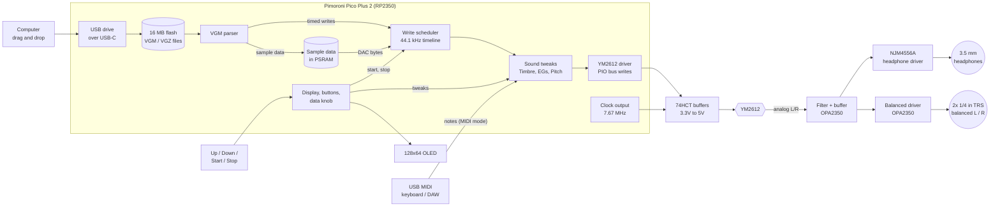

# Chip Shrine: YM2612 Player — Rev A Design

Status: Draft v0.8 · Oct 24, 2026 · Owner: Joey

> A small box with a real Sega Genesis sound chip, the Yamaha YM2612. Put VGM files
> onto it over USB-C like a thumb drive, pick a song with the buttons, and hear the
> real chip play it through headphones or balanced outputs into your studio.

**Rev A is the simplest, lowest-cost version that plays music.** It does VGM import and
playback and nothing else. The lights, synth knobs, fuller transport, and lit window
designed earlier are parked in [LATER-REVISIONS.md](LATER-REVISIONS.md) for Rev B and on.

Joey is drawing the schematic and PCB in a KiCad project called **YM2612 player**. This
doc is the reference for what goes on that board. Items marked **Proposal** are
recommendations waiting for Joey's OK; items marked **Open** still need a call.

---

## 1. What Rev A does

**Features (the whole list)**

1. **VGM import over USB-C:** plug the player into a computer and it shows up as a USB drive. Drag `.vgm` and `.vgz` files onto it. No memory card.
2. **Playback** on a real YM2612.
3. **Audio outputs:** a 3.5 mm headphone jack, plus **two balanced 1/4" TRS line outs** (L and R) for an audio interface. Target: **noise floor at or below −70 dB** (§5.5).
4. **A display** that shows the file being played.
5. **Four buttons:** Up, Down, Start, Stop.
6. **One data knob:** a push-and-turn encoder for Korg DS-8 style sound tweaks (Timbre, Timbre EG, Amp EG, Pitch) on any channel (§2.3).
7. **USB MIDI in** over the same USB-C cable, with two modes: **VGM mode** plays song files, **MIDI mode** plays the YM2612 like a synth from a keyboard or computer (§2.2). Costs no extra parts.

**Not in Rev A**

- Lights, the 4-knob panel, register editing, lit chip window (see [LATER-REVISIONS.md](LATER-REVISIONS.md)).
- Pause, next/previous, seek, loop, A-B repeat.
- Volume control (see Open questions, §8).
- Genesis PSG parts: only the YM2612 plays (decided Oct 23).
- DIN or TRS MIDI jacks (USB MIDI only), MIDI out, MIDI control of knobs.
- Other chips, battery, wireless.

## 2. How you use it

The player has two modes. The top entry of the track list is **MIDI MODE**: select it with Start
to switch to MIDI mode, and press Stop to go back to VGM mode.

### 2.1 VGM mode

1. To add songs, plug the player into a computer with a USB-C cable, drag files onto the **CHIPSHRINE** drive, then eject it.
   The player rescans its files after you eject.
2. To play, power it from the computer (after ejecting) or any USB-C charger. The display shows the first track.
3. **Up / Down** move through the track list.
4. **Start** plays the selected track. The display shows the name and elapsed time.
5. **Stop** stops playback and returns to the track list.
6. When a track ends, the player stops. If the file has a loop point, the looped part plays
   **twice**, then the player stops.

#### Display (128 × 64 OLED)

```
┌────────────────────────┐
│ ▶ 03/27        01:24   │   play state, track number / total, time
│ Green Hill Zone        │   title from the VGM's GD3 tag
│ Sonic the Hedgehog     │   game name (falls back to the filename)
│ PSG parts skipped      │   only shown when the file uses the PSG
└────────────────────────┘
```

When stopped, the screen shows a scrolling list of tracks with the selected one highlighted.

### 2.2 MIDI mode

1. Connect the player to a computer. It's a class-compliant USB MIDI device, so it needs no drivers on
   Windows or macOS and shows up in Ableton Live's MIDI preferences as **Chip Shrine**, alongside the USB drive.
   Turn on **Track** for it, then set a MIDI track's *MIDI To* to Chip Shrine, channel 1. Most keyboards with USB are themselves devices, not hosts,
   so playing straight from a keyboard needs a computer or a small USB MIDI host box in between.
2. Notes on **MIDI channel 1** play the YM2612 with **6-note polyphony** (one note per FM
   channel; when a 7th note arrives, the oldest note is stolen).
3. **Up / Down** pick the instrument. **Start** previews it with a test note. **Stop** returns to VGM mode.

**Where the instruments come from** (no menus needed):

- **Built-in presets:** a small bank of classic Genesis-style sounds stored with the firmware.
- **Borrowed from songs:** the player scans the VGM files on the drive and lists every
  distinct instrument it finds, named by song and channel, for example *Green Hill Zone · ch 2*.
- **Instrument files:** `.tfi` files (a common 42-byte YM2612 instrument format) dragged onto the drive show up too.

**What MIDI controls in Rev A:**

| MIDI message | Effect |
| --- | --- |
| Note on / off | Plays and releases notes |
| Velocity | Note loudness (carrier operator levels) |
| Pitch bend | ±2 semitones |
| Sustain pedal (CC 64) | Holds notes |
| Program change | Picks the instrument, same as Up/Down |
| All notes off (CC 123) | Silences the chip |

```
┌────────────────────────┐
│ MIDI  ch1      ♪ 3/6   │   mode, MIDI channel, notes sounding
│ Green Hill Zone · ch2  │   current instrument
│ 014 / 120              │   instrument number / total
│ ■ ■ ■ □ □ □            │   which of the 6 voices are playing
└────────────────────────┘
```

### 2.3 The data knob

One push-and-turn encoder, like the data slider on a Korg DS-8, gives the Korg-style
sound controls without a panel full of knobs. It works the same way in both modes: in VGM
mode it bends the song as it plays, and in MIDI mode it shapes the instrument you're playing.

- **Push** to step through the parameters: **Channel → Timbre → Timbre EG → Amp EG → Pitch** → back to Channel.
- **Turn** to change the one shown on the screen.
- **Hold for 2 seconds** to reset everything to the song (or instrument) as written.
- When stopped in VGM mode, turning the knob also scrolls the track list quickly.

| Parameter | Range | Under the hood | Sound |
| --- | --- | --- | --- |
| **Channel** | All, 1–6 | Which FM channel the next four act on. Each channel remembers its own settings | — |
| **Timbre** | −10 … +10 | Level (TL) of the *modulator* operators only | Dull to bright |
| **Timbre EG** | −10 … +10 | Attack and release rates of the modulators, together | How fast the brightness opens and fades |
| **Amp EG** | −10 … +10 | Attack and release rates of the carriers, together | Snappy to soft and swelling |
| **Pitch** | −12 … +12 semitones | Frequency/block offset | Pitch down/up |

0 always means "as written". The firmware knows each channel's algorithm, so it knows which
operators are modulators and which are carriers.

```
┌────────────────────────┐
│ ▶ 03/27        01:24   │
│ Green Hill Zone        │
│ CH 2   TIMBRE     +4   │   selected channel, parameter, value
│ ████████████░░░░░░░░   │   value bar, centre = as written
└────────────────────────┘
```

## 3. The chip: YM2612 at a glance

| Fact | What Rev A does about it |
| --- | --- |
| 6 FM channels with 4 operators each; channel 6 can play 8-bit samples (DAC) | Firmware plays all of it, including drum and voice samples |
| Two register banks, selected with address lines A0 and A1 | 2 GPIO lines |
| 24-pin DIP, 5V, NMOS | DIP socket; 3.3V → 5V buffers between the Pico and the chip |
| Clock about 7.67 MHz (NTSC Genesis) | Generated by the Pico, no oscillator part needed (§5.3) |
| Registers are write-only; the status byte can be read | Rev A never reads it. /RD is tied high, so the bus is one-way |
| Needs a short wait after each write | Fixed minimum gap, measured on a logic analyzer in M1 |
| Analog outputs MOL / MOR | Low-noise filter stage, then headphone and balanced drivers (§5.5) |

## 4. How it works

### 4.1 Audio pipeline



In plain words: the Pico reads a VGM file from its own flash memory, where you copied it over USB. The file is a list of "write
this value to this chip setting, then wait this long". One of the Pico's two cores
plays those writes to the YM2612 at the right moments. The other core runs the display
and buttons. The YM2612 makes the sound, and the op-amps clean it up and drive
the headphone jack and the balanced outputs.

### 4.2 Firmware modules

| Module | Job |
| --- | --- |
| **Storage** | A FAT filesystem in the board's flash (about 14 MB free after the firmware), read with FatFs. Builds the track list. |
| **USB** | TinyUSB composite device: a mass-storage drive called CHIPSHRINE plus a USB MIDI device called Chip Shrine. While the computer has the drive mounted, VGM playback is off; after eject, the player rescans the files. MIDI works either way. |
| **MIDI mode** | Voice allocator for 6 notes, note/velocity/pitch-bend/sustain handling, and an instrument library (presets, `.tfi` files, and instruments extracted from VGM files by watching which register sets each song writes). Writes go through the same YM2612 driver. |
| **VGM parser** | Reads the header (clock, length, loop point) and GD3 tags (title, game). Turns commands into timed writes: YM2612 port 0/1 writes, waits, PCM data blocks, DAC writes, and DAC stream commands. Skips PSG writes. VGZ files are unzipped while loading, which matters more now since storage is limited. |
| **Sample data** | Loads the song's PCM samples into the board's 8 MB PSRAM, so even sample-heavy tracks fit. |
| **Scheduler** | Runs on core 1. Releases each write at its exact sample time (1/44,100 s). Stops at the end, or after the loop has played twice. |
| **YM2612 driver** | PIO program: put A1/A0 and D0–D7 on the pins, pulse /WR, wait the minimum gap. Also pulses /IC (reset) at power-up and on Stop to silence the chip. |
| **Sound tweaks** | Applies the data knob's per-channel offsets (Timbre, Timbre EG, Amp EG, Pitch) to every write, in both modes, clamping values so nothing goes silent or painful. |
| **UI** | Runs on core 0. Debounces the 4 buttons, reads the data knob, switches between VGM and MIDI mode, and draws the OLED. Never delays a chip write. |

## 5. Hardware

### 5.1 Block diagram

```
Pico USB-C ── VBUS 5V ──────┬─ ferrite + caps ── YM2612, 74HCT buffers
                           ├─ ferrite + LC filter ── low-noise LDO 4.5V ── op-amps (analog rail)
                           └─ Pico's own 3.3V regulator ── Pico, OLED

Pico GPIO ── 2× 74HCT541 ── YM2612 (DIP socket) ── OPA2350 filter ─┬─ NJM4556A ── 3.5 mm headphones
                                                                   └─ OPA2350 inverter ── 2× 1/4" TRS balanced
     ├── I²C ── OLED module
     └── 4 buttons to GND
```

### 5.2 Parts (Proposal)

| Part | Choice | Rough cost |
| --- | --- | --- |
| Microcontroller | **Pimoroni Pico Plus 2** (RP2350, 16 MB flash, 8 MB PSRAM, USB-C), Pico-sized, soldered by its castellated edges or on headers | $12–15 |
| Sound chip | YM2612, pulled from a Model 1 Genesis or bought tested | $5–15 |
| Chip socket | 24-pin DIP, turned-pin | $0.50 |
| Level shifting | 2× 74HCT541 (one-way 3.3V → 5V buffers, powered from 5V) | $1 |
| Filter / buffer | OPA2350 low-noise, rail-to-rail dual op-amp rated for 2.7–5.5V (L and R) | $2 |
| Headphone driver | NJM4556A dual op-amp, AC-coupled output | $1 |
| Balanced driver | OPA2350 dual op-amp making the inverted (cold) leg for L and R | $2 |
| Analog supply | Low-noise LDO (about 4.5V, for example TPS7A20) plus LC filter | $1 |
| Audio jacks | 3.5 mm stereo headphone jack + 2× 1/4" TRS panel jacks | $3–4 |
| Display | 0.96" 128×64 SSD1306 OLED module, I²C, 4 pins | $2–3 |
| Buttons | 4× 6 mm tactile switches | $0.40 |
| Data knob | Rotary encoder with push switch (EC11 type) and a knob cap | $1 |
| Power and file loading | The Pico board's own USB-C port (no extra connector) | $0 |
| Passives | Decoupling, ferrites, op-amp resistors and caps, output caps | $2 |
| PCB | 2-layer, about 100 × 70 mm | about $1 each in a batch of 5 |

**Rough total: $30–40 per board** before the enclosure, mostly depending on the YM2612's price.

### 5.3 Cost savers in this design

- **No crystal oscillator for the chip.** The RP2350 runs at 153.33 MHz (12 MHz × 115 ÷ 9),
  and its clock-output pin divides that by 20 to give **7.667 MHz**, within 0.05% of
  a real Genesis (less than 1 cent of pitch). The clock goes through a spare 74HCT541
  channel to reach 5V levels. **Proposal:** add an unpopulated footprint for an oscillator
  can as a fallback.
- **No busy-flag reads,** so the buffers only go one way and /RD is tied high.
- **No memory card, USB connector, regulator, or power switch.** The Pico board's USB-C port loads files and powers everything.
- **No volume control** (see §8).

### 5.4 Pin map (Proposal)

Consecutive pins keep the PIO program simple. The Pico Plus 2 uses the standard Pico header for GP0–GP28. Check each pin against its pinout in KiCad.

| Pico GPIO | Signal | Goes to |
| --- | --- | --- |
| GP0–GP7 | D0–D7 | 74HCT541 #1 → YM2612 data bus |
| GP8 | A0 | 74HCT541 #2 → YM2612 |
| GP9 | A1 | 74HCT541 #2 → YM2612 |
| GP10 | /WR | 74HCT541 #2 → YM2612 |
| GP11 | /IC (reset) | 74HCT541 #2 → YM2612 |
| GP21 | Clock out (GPOUT0) | 74HCT541 #2 → YM2612 φM |
| GP12 | Button Up | to GND, internal pull-up |
| GP13 | Button Down | to GND, internal pull-up |
| GP14 | OLED SDA (I²C1) | OLED |
| GP15 | OLED SCL (I²C1) | OLED |
| GP20 | Button Start | to GND, internal pull-up |
| GP22 | Button Stop | to GND, internal pull-up |
| GP16 | Data knob A | encoder, internal pull-up |
| GP17 | Data knob B | encoder, internal pull-up |
| GP18 | Data knob push | to GND, internal pull-up |
| — | /CS tied low, /RD tied high | YM2612 |

### 5.5 Audio output and the −70 dB target

**Signal path**

- MOL and MOR each go through a load resistor into an **OPA2350** stage that buffers and
  low-pass filters them, based on a known-good Genesis Model 1 output stage.
- From there, each channel splits two ways:
  - **Headphones:** an NJM4556A drives the 3.5 mm jack through about 220 µF output capacitors.
  - **Balanced line out:** the filter output is the *hot* leg, and a second OPA2350 makes an
    inverted *cold* leg. Both go through 100 Ω resistors and DC-blocking capacitors to a 1/4"
    TRS jack (tip = hot, ring = cold, sleeve = ground). A 5V board can only swing about 3 V
    per leg, but balanced doubles that between hot and cold, so the line out reaches about
    2 V RMS.

**Why balanced:** in the studio, the player is on USB to the PC and its audio goes into an
audio interface on the same PC. That creates a ground loop, the usual cause of hum and USB
whine. A balanced input on the interface rejects noise that appears equally on hot and cold,
so the loop stops mattering.

**Target:** idle noise floor **at or below −70 dB relative to full-scale output**, 20 Hz–20 kHz,
measured on the balanced outs into an audio interface with the player on USB to the same PC.
That level of hiss is easy for these op-amps. The work is keeping digital noise out:

- **Analog rail:** USB 5V → ferrite → LC filter → low-noise LDO (about 4.5V) for the op-amps
  only. The 2.25V mid-rail reference gets its own RC filter and a large capacitor.
- **Grounds:** a solid analog ground area under the audio section, joined to digital ground at
  one point. USB, the bus, and the clock never cross the analog area.
- **The chip:** the YM2612's own supply gets its own ferrite and decoupling, and its outputs
  leave on short traces straight into the analog section.
- **Spare footprints:** room for an extra filter stage and a ground-lift resistor, in case
  measurements in M4 call for them.

While music plays, the YM2612's own 9-bit DAC adds its well-known grit. That's the chip's
character, not noise from the board, and it isn't part of the −70 dB figure.

### 5.6 Protecting the chip

- Series resistors (about 100 Ω) on every buffer output into the YM2612.
- The YM2612 is socketed and only gets 5V through a ferrite and decoupling right at its pins.
- Keep a spare YM2612 on hand. Buy from a seller with returns, since pulled and fake chips are common.

## 6. KiCad notes for Joey's "YM2612 player" project

- Symbols you may need to make: YM2612 (DIP-24) and the OLED module (4-pin header).
  The Pico Plus 2 uses the standard Pico footprint (Raspberry Pi's official KiCad footprint works).
- Put the YM2612, buffers, and op-amp on the 5V side of the board, and the OLED on the 3.3V side.
- Keep the 7.67 MHz clock trace short, and away from the audio traces.
- Place the headphone jack, both 1/4" TRS jacks, and the Pico board's USB-C port on board edges so the case can expose them.
- Keep the analog section (op-amps, LDO, jacks) in one corner, away from the Pico, bus, and clock.
- Add test points for D0–D7, A0, A1, /WR, and the clock for the logic analyzer in M1.

## 7. Milestones

| # | Milestone | Done when |
| --- | --- | --- |
| M0 | **Parts in hand** | Tested-good YM2612 (plus a spare), Pico Plus 2, buffers, op-amp, OLED |
| M1 | **First sound** | Breadboard: the Pico clocks the YM2612 and plays a hard-coded FM note; write gap measured |
| M2 | **Play a VGM** | Files dragged on over USB-C appear on the drive, and a Genesis VGM plays start to finish, samples included |
| M3 | **Display + buttons** | Track list, Up/Down/Start/Stop, title and time on the OLED |
| M3a | **Data knob** | Timbre, Timbre EG, Amp EG, and Pitch audibly bend a playing song, per channel, and reset cleanly |
| M3b | **MIDI mode** | A USB keyboard or DAW plays 6-note chords on the YM2612 using built-in and borrowed instruments |
| M4 | **Quiet audio** | Idle noise floor at or below −70 dB on the balanced outs into an interface on the same PC; no hum or whine on headphones |
| M5 | **Schematic + PCB** | Joey's KiCad project matches this doc; boards ordered |
| M6 | **Rev A built** | Assembled board loads files over USB-C and plays them in a simple case |

## 8. Open questions

- [ ] **Headphone volume:** the balanced outs stay at a fixed line level, but the headphone jack may be
  loud. Add a small dual volume wheel on the headphone output only (about $0.50)?
- [ ] **Buttons:** four buttons (Up, Down, Start, Stop), or three with Start/Stop as one toggle?
- [ ] **Clock:** Pico-generated clock (proposed), or an oscillator can for exact Genesis pitch?
- [x] **File loading:** over USB-C into the board's flash, no microSD (Joey, Oct 24).
- [ ] **VGZ:** proposed as required in Rev A, since zipped files stretch the 16 MB of storage.

## 9. Glossary

- **VGM / VGZ:** "Video Game Music", a recording of every chip write a game made, with timing. VGZ is the zipped version.
- **GD3 tag:** the part of a VGM file that holds the track title, game, and composer.
- **Register:** a tiny memory slot in the chip; writing a number to it changes pitch, volume, or tone.
- **PIO:** programmable I/O blocks on the RP2350 that toggle pins with exact timing.
- **DAC:** the YM2612's sample-playback mode on channel 6, used for drums and voices.
- **PSG:** the Genesis's second, simpler sound chip. Rev A doesn't play its parts.
- **Level shifting:** converting the Pico's 3.3V signals to the 5V the YM2612 expects.
