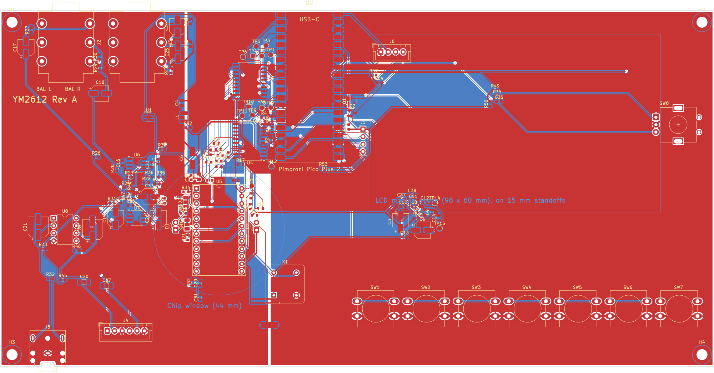

# YM2612 player hardware (Rev A)

The Rev A board, drawn in KiCad. It follows [docs/DESIGN.md](../docs/DESIGN.md). The goal is a
**PCBWay turnkey prototype**: PCBWay makes the board, buys the parts and solders them on. Joey supplies
the YM2612 and plugs it into the socket.

**Status:** schematic and first PCB layout done. Both pass KiCad's checks (ERC: 0 errors; DRC in KiCad 10: 0 errors,
0 unconnected, matches the schematic). Not ordered yet: see "Still to do before ordering".

**Just want to look?** Open [ym2612_player/ym2612_player.pdf](ym2612_player/ym2612_player.pdf). GitHub shows it in the browser.
The parts list is [ym2612_player/bom.csv](ym2612_player/bom.csv).
The board, seen from the top:

## Opening it in KiCad

1. Install KiCad (any version from 7 up) from <https://www.kicad.org/download/>.
2. Download this repository: on GitHub click the green **Code** button, then **Download ZIP**, and unzip it.
   (While this is still a pull request, pick its branch in the branch menu at the top left first.)
3. In KiCad choose **File > Open Project** and pick `hardware/ym2612_player/ym2612_player.kicad_pro`.
4. Double-click **ym2612_player.kicad_sch**. The first page has one box per page; double-click a box to go in,
   **Alt + Backspace** to come back out.

The files are saved in KiCad 7 format. Newer KiCad opens them and offers to upgrade them the first time you save.
If you'd rather keep working in your own **YM2612 player** project, copy these files into it, or ask Claude to do it
through folder access.

**Reading the drawing:** wires end in name tags (labels). Any two tags with the same name are connected, even on
different pages. `+5V`, `+5V_YM`, `+4V5A`, `+3V3`, `GND` and `GNDA` are power connections. A blue X means "not
connected on purpose". A part crossed out in red is "do not fit": it has a footprint but PCBWay leaves it off.

## Pages

| Page | What's on it |
| --- | --- |
| Power | 5V from the Pico's USB-C, a ferrite-filtered 5V for the chip, and a quiet 4.5V LDO rail for the audio |
| Controller | Pimoroni Pico Plus 2 soldered flat, boot-time pull resistors, spare-pin header, test points |
| Sound chip | YM2612 socket, two 74HCT541 buffers (3.3V to 5V) with 100 ohm resistors, clock options, window LEDs |
| Audio out | Model 1 style filter, balanced 1/4" outs, headphone amp with the dual slide volume |
| Front panel | 7 buttons (12 mm), data knob, I2C level shifter, LCD connector |

## The board

240 x 120 mm, 2 layers, rear edge at the top of the picture. Positions below are part centres, measured in mm from
the board's rear-left corner (x to the right, y towards the front). They are what the case needs.

| What | Where |
| --- | --- |
| M3 mounting holes | (4, 4), (236, 4), (4, 116), (236, 116) |
| Balanced 1/4" outs L / R (rear) | x 30.3 and 54.3, on the rear edge |
| Pico Plus 2 USB-C (rear) | x 104, on the rear edge |
| 3.5 mm headphone jack (front) | x 16, on the front edge |
| Volume slider plug (6-pin JST XH) | (36, 108); the slider itself sits in the case top |
| YM2612 socket / round chip window | window centre (73.6, 74), 44 mm across |
| LCD module (98 x 60 mm, on 15 mm standoffs) | from (124, 8) to (222, 68); its connector J6 at (128, 14) |
| 7 buttons, 12 mm | one row at y 98, from x 120 (Play) to x 222 (Write), 17 mm apart |
| Data knob (encoder) | (220.5, 36) |

Ground: the audio area (left, `GNDA`) and the digital area (right, `GND`) have their own copper pours, joined only at
NT1 beside the chip.

## Ordering from PCBWay (turnkey)

Everything PCBWay asks for is in [ym2612_player/fab](ym2612_player/fab):

- `ym2612_player_gerbers.zip`: the board itself (copper, solder mask, silkscreen, outline, drill holes).
- `ym2612_player_bom.csv`: the parts list. Lines marked "Do not fit" are left off on purpose.
- `ym2612_player_cpl.csv`: where each part goes and which way it turns (the "placement" or "centroid" file).

Upload the zip on PCBWay's PCB Assembly page, choose Turnkey, then add the BOM and CPL when it asks. They check every
part before anything is made and email questions. Nothing is charged until you approve their quote.

## Choices made in this draft

- **Pico Plus 2 soldered flat** by its castellated edges (Digi-Key part PIM724, so PCBWay can buy it). Lowest
  height, nothing to wiggle loose. If you'd rather have it removable, it can sit on two 20-pin sockets instead.
- **YM2612 socket:** Mill-Max turned-pin, 24-pin, 600 mil wide. PCBWay solders the socket only.
- **Clock:** the Pico makes the 7.67 MHz clock (as the design doc proposes). There's an unfitted footprint for a
  7.670454 MHz oscillator can, so switching to exact Genesis pitch is a two-part change with no new board.
- **Buttons:** 12 mm Omron B3F-4055 switches with snap-on round caps (your choice, Oct 24).
- **Analog rail:** LP5907 4.5V low-noise regulator after a ferrite and an LC filter.
- **Grounds:** digital `GND` and analog `GNDA` are joined at one point (NT1), to be placed beside the YM2612.
- **Audio filter:** 2.2k load, then a 3.39 kHz first-order low-pass (Model 1 style). See DESIGN.md 5.5.
- **Balanced outs:** hot and cold legs from OPA2350s, 100 ohm + 10 µF each, Neutrik NMJ6HCD2 jacks, with a 0 ohm
  ground-lift footprint on each sleeve.

## Still to do before ordering

1. **Case check:** the positions above are a first guess. Check them against your enclosure and say what should move.
2. **Pico Plus 2 footprint check:** `ym2612.pretty/Pimoroni_PicoPlus2_SMD` uses the standard Pico pad positions.
   Check it against a real board or Pimoroni's drawing before ordering.
3. **Window LEDs:** pick an exact warm-white 3 mm LED for PCBWay (any will do electrically).
4. **Silkscreen tidy-up:** some part labels overlap pads or each other. This doesn't affect how the board works.

## Regenerating

`tools/build.sh` rebuilds the schematic from `tools/design.py`, checks every connection against the netlist, and
re-exports the PDF and BOM (needs KiCad installed). Once anyone edits the schematic in KiCad, the KiCad files become
the real source and the script should not be rerun.

`tools/layout.py` places the parts on the board, `tools/route.py` routes it with Freerouting, and `tools/fab.sh` makes
the PCBWay files. The same rule applies: once the board has been edited in KiCad, edit it there.
